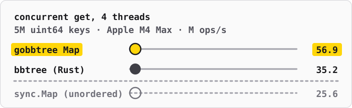
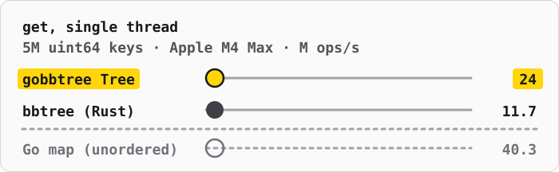

# gobbtree

[](https://github.com/thesyncim/gobbtree/actions/workflows/test.yml)
[](https://github.com/thesyncim/gobbtree/actions/workflows/amd64-simd.yml)

**Fast ordered maps and sets for Go, ported from Rust's [bbtree](https://github.com/XiangpengHao/bbtree).** It is a B+ tree whose nodes keep compact summaries of their keys and search them with SIMD, so most lookups never touch a full key.

1. Faster than the Rust original in 190 of the 192 `uint64` timings of the [benchmarks](#benchmarks): 1.8× its lookup throughput on one thread and 1.5× on four, on 5M keys. Rust still builds faster in 17 of the 24 build cells, ascending keys 1.2–2.9× as fast, and wins 10 of the 22 byte-string cells.
2. `Map` is concurrent, with upstream's optimistic latching: lookups descend without locking, checking node versions, and writers latch only the leaf they change. On four threads it serves 2.3× the lookups of `sync.Map`, with its keys in order.
3. From 5M entries up, peak memory 21–33% below the Rust original's on clustered keys, within 3% of it on mixed keys, and 4–8% above it on sequential ones.
4. Any `cmp.Ordered` key, your own orders through a two-method `Key` interface, and `[]byte` keys.
5. File maps in upstream's format: write a snapshot, then query it in place through `mmap`. Go and Rust read each other's files.
6. Pure Go: no assembly, cgo or dependencies. The SIMD comes from Go 1.27's `simd` package.
7. Checked against upstream itself: CI compares containers and files with a live Rust oracle, besides the race detector and fuzzing.



## Usage

```sh
go get github.com/thesyncim/gobbtree
```

gobbtree needs Go 1.27. Build with `GOEXPERIMENT=simd` to search with [SIMD](#simd); without it, the same code searches with scalar loops.

### Concurrent map

```go
m := gobbtree.New[uint64, uint64]() // the zero value works too

var wg sync.WaitGroup
wg.Go(func() { m.Insert(1, 10) })
wg.Go(func() { m.Insert(2, 20) })
wg.Wait()

v, ok := m.Get(1)                                   // 10, true
m.Read(2, func(_, v uint64) { fmt.Println(v + 1) }) // 21

got := make([]gobbtree.Result[uint64], 3)
m.GetMany([]uint64{1, 2, 3}, got) // {10 true} {20 true} {0 false}
```

### Single owner

```go
t := gobbtree.NewTree[int, string]()
t.Insert(1, "one")
t.Insert(2, "two")
t.Insert(3, "three")

v, ok := t.Get(1) // "one", true

for k, v := range t.Range(1, 3) { // keys in [1, 3): 1, then 2
    fmt.Println(k, v)
}
for k, v := range t.ScanReverse(gobbtree.Above(1).AtMost(3)) { // 3, then 2
    fmt.Println(k, v)
}
```

### Containers

| Type | Made by | For |
|---|---|---|
| `Map[K, V]` | `New` | Concurrent readers and writers |
| `Tree[K, V]` | `NewTree` | A single owner; concurrent reads only while nobody writes |
| `Set[K]` | `NewSet` | A single owner's set, with union, intersection, difference and subset tests |
| `MapOf`, `TreeOf`, `SetOf` | `NewMapOf`, `NewTreeOf`, `NewSetOf` | The same three, for [custom keys](#custom-keys) and `[]byte` keys (`Bytes`) |
| `FileMap[K, V]` | `ReadFile`, `Mmap(path).Open()` | A read-only snapshot, searched in place ([file maps](#file-maps)) |

`Map` and `Tree` share one API, from `Get`, `Insert`, `Delete` and `Take` to batches (`GetMany`, `InsertMany`), read-modify-write (`Update`, `UpdateOrInsert`, `LoadOrStore`) and iterators (`All`, `Range`, `Scan` over any `Bounds`, `Ascend`, `Descend` and their reverses). `Map`'s read-modify-writes are atomic, and it adds callback reads (`Read`, `ReadMany`) and `DeleteIf`. `Tree` adds upstream's `Entry` API and ordered editing (`LowerBound`, `SplitOff`, `Retain`, `ExtractIf`, …). [Coming from bbtree](#coming-from-bbtree) lists every operation.

- Iterators are range-over-func sequences, so `break` stops them.
- Keys follow `cmp.Compare`: NaN sorts first and `-0 == +0`. Inserting an equal key keeps the stored key.
- Keys and values are copied shallowly.
- The in-memory containers' zero values are ready to use. Don't copy a container after first use.

### Custom keys

A type orders itself by implementing `Key`: `Compare` defines the order, and `Window` exposes it to the SIMD search.

```go
type Key[K any] interface {
    Compare(other K) int
    // Bytes offset..offset+8 of an encoding that sorts like Compare,
    // big-endian and zero past its end.
    Window(offset int) uint64
}
```

For example, names ordered case-insensitively:

```go
type Tag string

func (t Tag) Compare(o Tag) int {
    return strings.Compare(strings.ToLower(string(t)), strings.ToLower(string(o)))
}

func (t Tag) Window(offset int) uint64 {
    return gobbtree.StringWindow(strings.ToLower(string(t)), offset)
}

tags := gobbtree.NewMapOf[Tag, int]()
tags.Insert("Go", 1)
tags.Insert("GO", 2) // the same key: replaces the value, keeps "Go"
```

Byte-slice keys are built in as `Bytes`:

```go
index := gobbtree.NewMapOf[gobbtree.Bytes, int]()
buf := []byte("user:42")
index.Insert(buf, 1)    // stores a copy: buf may be reused
v, ok := index.Get(buf) // lookups don't allocate or keep buf
```

A composite key encodes its fields one after another, for example a `uint32` tenant as four big-endian bytes followed by a name; `StringWindow`, `BytesWindow` and `Uint64Window` window the common encodings. Equal keys must have equal windows. Windows that tie are settled by `Compare`, so even a constant `Window` is correct, only slower. A key that refers to reusable memory also implements `Clone() K`, and containers store a clone of each new key.

### File maps

```go
tree := gobbtree.NewTree[string, int]()
tree.Insert("alpha", 1)
if err := tree.WriteFile("index.bbt"); err != nil { // Map and Set write files too
    log.Fatal(err)
}

disk, err := gobbtree.Mmap[string, int]("index.bbt").Open() // or ReadFile
if err != nil {
    log.Fatal(err)
}
defer disk.Close()
value, found := disk.Get("alpha") // 1, true
```

A file map searches the image in place, with no rebuild, and supports `Get`, `GetMany` and iteration in both directions over any bounds. Files use upstream's version 1 format, which the Rust oracle tests both ways.

- **Types:** integer and string keys; number, plain-array, empty-struct, string and byte-slice values.
- **Checking:** `ReadFile`, `ReadFileRange` and `OpenFileMap` check every page, as upstream's do. `Mmap(...).Open()` and `OpenFileMapUnchecked` check the header alone: a corrupt file may give wrong answers or panic, but is never read out of bounds. A mapped file truncated under its map makes the reads that reach past its end panic.
- **Reading:** reads take no lock and run in parallel. `Close` is safe beside them: reads in progress finish on the snapshot, and a mapping is unmapped once none holds it.
- **Writing:** `WriteFile` replaces the file atomically, syncing it and its directory, keeps the permissions of a file it replaces, and writes through a symbolic link. `CreateFile` writes one from an ascending `iter.Seq2`. `NewFileWriter`, `WriteAt`, `ReadFileRange` and `Mmap(...).Range` handle snapshots inside larger files; `Mmap(...).Pages(OsPagesHuge)` advises huge pages on Linux.
- **Immutable:** to change a file map, write a new snapshot.

## Concurrency

`Map` ports the protocol of upstream's `BBTreeMap` ([design](https://github.com/XiangpengHao/bbtree/blob/8ef597b5b8d957531d88871bdb566f391206f860/design/09-concurrency.md)). Every node carries a latch word with a version. Lookups descend optimistically, checking each node's version, and write nothing. Writers latch only the leaf they change; a split or merge takes only the nodes it changes, without waiting, and starts over if another goroutine holds one. No lock or counter is shared by all writers, so writes scale with cores. Lookups of custom keys, and of string keys a leaf's summaries don't settle, read the leaf under its shared latch, as upstream's do for keys it can't read inline. A lookup whose leaf keeps changing takes that latch too, which lets readers progress behind a hot leaf.

Beyond upstream, every node keeps its fences, the bounds of the keys under it, and a table of hints jumps from a key straight to its leaf. A hint is checked against the leaf's version and fences before it is used, so a stale one costs only a descent from the root.

- **Iteration** keeps upstream's `range_cloned` contract, also for `Scan`: it copies a few leaves at a time and visits the copies with nothing held, so the loop body may use the map. (Upstream's `scan` runs its closure under each leaf's read latch.) Iteration is not a snapshot: an entry present throughout is visited exactly once, and entries inserted or removed meanwhile may or may not be.
- **Batches** are consistent per entry; a batch is not a transaction.
- **Callbacks** of `Read`, `ReadMany`, `Update`, `UpdateOrInsert` and `DeleteIf` run under the entry's leaf latch, as upstream's do, and must not use the same map. A panicking callback releases its latches and stores nothing, as Go programs may recover; upstream instead asks that user code never panic, and leaves what a map holds after one unspecified.
- **No `Len`**, as upstream's shared map has none. `IsEmpty` reports whether the map held no entry at some moment during the call. `Clear`, like upstream's `clear(&mut self)`, is the owner's: no other goroutine may use the map until it returns.

## Coming from bbtree

The API follows upstream's operations with Go names. Results are multiple return values, and iterators are range-over-func sequences.

| Upstream | gobbtree |
|---|---|
| `get` · `get_copied` · `get_cloned` · `contains_key` · `get_key_value` | `Get` · `Contains` · `GetKeyValue` |
| `insert` · `remove` · `remove_entry` | `Insert` · `Delete` · `Take` |
| `get_many_*` · `insert_many` · `read_many` · `update_or_insert_many` | `GetMany` · `InsertMany` · `ReadMany` · `UpdateOrInsertMany` |
| `read` · `update` · `update_or_insert` · `get_or_insert` · `remove_if` | `Read` · `Update` · `UpdateOrInsert` · `LoadOrStore` · `DeleteIf`; callbacks see the stored key, and return results through the closure |
| `get_mut` · `iter_mut` · `values_mut` · `range_mut` | `Update` · `UpdateAll` · `UpdateRange`: Go can't lend a reference into a leaf, so values go out and back |
| `entry` · `first_entry` · `last_entry` | `Entry` · `FirstEntry` · `LastEntry`, with `OrInsert` · `OrInsertWith` · `OrInsertWithKey` · `OrDefault` · `AndModify` · `Insert` · `InsertEntry` · `Remove` |
| Ranges `a..b` · `a..=b` · `a..` · `..b` · `..=b` · `(Excluded(a), _)` | `Between(a, b)` · `AtLeast(a).AtMost(b)` · `AtLeast(a)` · `Below(b)` · `AtMost(b)` · `Above(a)…`; invalid bounds panic as upstream's do |
| `iter` · `range` / `range_cloned` / `scan` · `scan_rev` · `iter().rev()` | `All` · `Scan` · `ScanReverse` · `Reverse` |
| `keys` · `values` · `first_key_value` · `last_key_value` · `first_copied` · `pop_first` · `pop_last` | `Keys` · `Values` · `First` · `Last` · `FirstIn` · `PopFirst` · `PopLast` |
| `retain` · `extract_if` · `split_off` · `append` · `Extend` · `FromIterator` | `Retain` · `ExtractIf` · `SplitOff` · `Append` · `InsertAll` |
| set `contains_many` · `replace` · `take` · `union` · `intersection` · `difference` · `symmetric_difference` · `is_subset` | the same names on `Set` |
| `Clone` · `PartialEq`/`Eq` · `PartialOrd`/`Ord` · `Debug` · `into_iter`/`into_keys`/`into_values` | `Clone` · `EqualFunc`/`Equal` · `CompareFunc`/`Compare` · `String` · `Drain` |
| `InlineKey` (`inline_key_at`) · byte-string keys, which compare from where they differ (`cmp_from`) | `Key` (`Window`) · `Bytes`; string and `Bytes` keys compare from where they differ |
| `LeafAnnex` · `WithLeafAnnex` · `update_or_insert_with_leaf` · `remove_with_leaf` · `AnnexedLeaf::annex` · `keys` | `LeafAnnex` · `AnnexedMapOf` · `UpdateOrInsertWithLeaf` · `DeleteWithLeaf` · `AnnexedLeaf.Annex` · `Keys`, for keys ordered by `Key`; a callback refuses by returning false, and `ReplaceKey` replaces a key with an equal one, as upstream's keys change in place |
| `FileWriter::from_ascending` · `byte_len` · `write` | `NewFileWriter` · `ByteLen` · `WriteTo`; a container's `WriteFile` writes one directly |
| `FileMap::open` · `open_unchecked` · `NotAscending::index` | `OpenFileMap` · `OpenFileMapUnchecked` · `NotAscendingError.Index` |
| bbtree-mmap `create` · `write_at` · `read` · `read_range` · `mmap().range().pages().open()` | `CreateFile` · `WriteAt` · `ReadFile` · `ReadFileRange` · `Mmap().Range().Pages().Open()` |

Beyond upstream:

- **`Map`:** `First`, `Last`, `PopFirst`, `PopLast`, `LoadOrStoreFunc`, `UpdateAll` and `UpdateRange`.
- **`Tree`:** `LowerBound`, `UpperBound`, `LoadOrStore`, `LoadOrStoreFunc` and `UpdateOrInsert`.
- **`FileMap`:** `ByteLen`, `WriteTo` and `Close`.
- **Everywhere:** `Range(lo, hi)` and `RangeReverse` as shorthands for scanning `Between(lo, hi)`, and `Ascend(from)` and `Descend(from)` for scanning from a key.

Not carried over, because Go has no counterpart:

- **Rust-only traits:** no operator overloading for `Index` (use `Get`), and no `Hash`.
- **Allocators and `InsertError`:** Go's allocation failure is fatal, so `Insert` has no error path.
- **`NodeConfig` page sizes:** nodes hold a fixed 32 entries. Go generics can index an array type parameter but can't slice it or point into it, which shifting entries and the SIMD searches need, so another size would mean another copy of the node code.
- **The rest of `InlineKey`** (`WIDTH`, `hash_tag`, `cmp_prefix`, and `cmp_from` on custom keys): these tune upstream's node layout, and a generic Go container can't call an optional key method without boxing the key.
- **The `inspect` and `check_invariants` debugging helpers.**

## SIMD

| Target | Search kernels |
|---|---|
| amd64 | AVX-512 or AVX2, chosen at run time, with a 128-bit fallback |
| arm64 | NEON |
| Others | Go's portable SIMD where available, otherwise scalar |

`gobbtree.SIMD()` reports whether the build uses hardware SIMD, and its vector width. `GODEBUG=simd=0` forces the scalar path.

## Benchmarks



gobbtree's `Tree` and `Map` against Rust bbtree's `unsync::BBTreeMap` and `BBTreeMap` on an Apple M4 Max: Go 1.27.3 with `GOEXPERIMENT=simd` at [`ba66888`](https://github.com/thesyncim/gobbtree/commit/ba66888a8579c0cd13f35112d7e128c2f22513cc), Rust 1.99.1 with native CPU tuning, full LTO and mimalloc at [`1c72bd2`](https://github.com/XiangpengHao/bbtree/tree/1c72bd27994ed0a38694b029618e80115e22644f). Each cell is the median of three fresh-process runs over identical keys, with checked results.

gobbtree is faster in 190 of the 192 `uint64` timings below; Rust wins Map 4 workers · 10% writes at 4K mixed keys; Map delete + reinsert same key at 5M mixed keys. Go builds faster in 7 of 24 build cells, at 0.34× to 2.31× Rust's speed. Go's process peaks 3.4–3.5 MB higher at 4K, 1.9–4.2 MB higher at 262K, from 38.9 MB lower to 9.7 MB higher at 5M, from 617.6 MB lower to 46.3 MB higher at 50M entries, against Rust's.

With byte-string keys, Go `Bytes` against Rust `String`, Go wins 12 of 22 cells.

The tables cover `uint64` keys and values from 4K to 50M entries, with mixed keys (hashed keys spread over the full 64-bit range), sequential keys (consecutive even keys; misses and fresh keys fill the gaps) and clustered keys (runs of 1,024 consecutive even keys at scattered bases). Batch cells are per key, churn cells per delete-and-insert pair, and parallel cells use four workers.

<details>
<summary>Times, mixed keys — Go / Rust, ns/op</summary>

**Tree**

| Workload | 4K | 262K | 5M | 50M |
|---|---:|---:|---:|---:|
| Read hit | 7.78 / 12.79 | 11.11 / 24.36 | 52.85 / 95.14 | 70.90 / 134.34 |
| Read miss | 8.17 / 12.10 | 10.90 / 23.43 | 33.78 / 79.18 | 59.08 / 125.06 |
| Batch hit · 8 keys | 7.55 / 12.35 | 11.20 / 23.31 | 41.85 / 58.29 | 52.90 / 86.03 |
| Batch miss · 8 keys | 8.19 / 12.25 | 10.66 / 20.69 | 30.61 / 45.82 | 46.84 / 69.79 |
| Replace value | 9.02 / 13.17 | 16.13 / 26.63 | 75.23 / 97.09 | 95.31 / 146.69 |
| Delete + reinsert same key | 49.09 / 77.17 | 68.21 / 119.97 | 233.03 / 268.88 | 317.88 / 389.14 |
| Delete + insert new key | 57.92 / 101.43 | 93.89 / 153.89 | 319.73 / 391.90 | 425.26 / 588.32 |

**Map**

| Workload | 4K | 262K | 5M | 50M |
|---|---:|---:|---:|---:|
| Read hit | 8.38 / 13.89 | 15.39 / 28.59 | 69.19 / 105.35 | 86.58 / 144.24 |
| Read miss | 9.38 / 12.81 | 14.41 / 26.15 | 48.67 / 80.41 | 74.61 / 128.31 |
| Batch hit · 8 keys | 8.76 / 13.90 | 12.79 / 22.34 | 40.98 / 57.55 | 55.66 / 82.09 |
| Batch miss · 8 keys | 9.46 / 13.09 | 11.94 / 19.96 | 34.85 / 45.59 | 48.68 / 67.32 |
| Replace value | 10.94 / 15.01 | 23.57 / 30.90 | 82.70 / 130.91 | 103.04 / 173.40 |
| Delete + reinsert same key | 53.69 / 77.51 | 79.95 / 115.56 | 267.48 / 266.14 | 328.42 / 393.19 |
| Delete + insert new key | 64.33 / 108.27 | 110.26 / 156.15 | 394.72 / 396.15 | 527.02 / 602.32 |
| 4 workers · reads | 2.31 / 4.15 | 3.97 / 7.73 | 17.55 / 26.64 | 22.56 / 37.66 |
| 4 workers · 10% writes | 7.45 / 6.79 | 6.91 / 9.77 | 19.33 / 27.54 | 23.82 / 39.74 |

</details>

<details>
<summary>Times, sequential keys — Go / Rust, ns/op</summary>

**Tree**

| Workload | 4K | 262K | 5M | 50M |
|---|---:|---:|---:|---:|
| Read hit | 6.47 / 12.08 | 9.69 / 24.48 | 47.70 / 86.17 | 66.17 / 120.13 |
| Read miss | 6.52 / 11.24 | 8.37 / 22.51 | 28.94 / 62.40 | 48.86 / 112.26 |
| Batch hit · 8 keys | 7.14 / 12.09 | 9.85 / 22.37 | 39.51 / 55.09 | 55.09 / 79.17 |
| Batch miss · 8 keys | 6.85 / 11.23 | 8.80 / 20.22 | 26.11 / 38.81 | 41.45 / 68.09 |
| Replace value | 7.70 / 12.53 | 15.22 / 25.89 | 73.48 / 97.62 | 99.42 / 141.04 |
| Delete + reinsert same key | 47.92 / 80.01 | 66.32 / 123.73 | 231.24 / 255.33 | 311.47 / 372.50 |
| Delete + insert new key | 44.85 / 64.98 | 67.15 / 118.51 | 255.31 / 268.27 | 328.77 / 368.90 |

**Map**

| Workload | 4K | 262K | 5M | 50M |
|---|---:|---:|---:|---:|
| Read hit | 7.76 / 13.61 | 13.17 / 29.15 | 62.69 / 104.53 | 87.16 / 143.01 |
| Read miss | 7.50 / 12.83 | 11.14 / 26.54 | 43.45 / 69.29 | 65.92 / 125.43 |
| Batch hit · 8 keys | 8.14 / 13.92 | 10.72 / 22.86 | 44.42 / 54.35 | 57.54 / 82.28 |
| Batch miss · 8 keys | 7.99 / 13.07 | 9.63 / 21.24 | 28.70 / 41.15 | 44.56 / 65.90 |
| Replace value | 9.45 / 14.95 | 19.33 / 33.99 | 80.97 / 120.54 | 111.87 / 182.09 |
| Delete + reinsert same key | 52.86 / 80.11 | 75.99 / 121.06 | 245.31 / 262.62 | 338.71 / 378.93 |
| Delete + insert new key | 48.76 / 87.75 | 77.32 / 116.94 | 270.44 / 278.98 | 345.50 / 360.22 |
| 4 workers · reads | 2.09 / 3.42 | 3.55 / 7.41 | 16.88 / 24.93 | 21.06 / 36.11 |
| 4 workers · 10% writes | 6.28 / 6.78 | 6.14 / 9.97 | 19.70 / 28.95 | 24.42 / 38.78 |

</details>

<details>
<summary>Times, clustered keys — Go / Rust, ns/op</summary>

**Tree**

| Workload | 4K | 262K | 5M | 50M |
|---|---:|---:|---:|---:|
| Read hit | 8.52 / 27.07 | 16.14 / 53.20 | 74.26 / 205.34 | 141.86 / 401.35 |
| Read miss | 9.02 / 25.47 | 15.67 / 48.88 | 55.41 / 176.69 | 101.90 / 386.12 |
| Batch hit · 8 keys | 7.55 / 24.99 | 15.12 / 47.55 | 64.12 / 153.75 | 107.71 / 233.24 |
| Batch miss · 8 keys | 7.30 / 24.16 | 14.12 / 43.39 | 49.91 / 142.31 | 96.56 / 227.75 |
| Replace value | 10.73 / 28.82 | 22.37 / 58.55 | 98.51 / 267.13 | 154.18 / 454.84 |
| Delete + reinsert same key | 52.37 / 125.53 | 85.96 / 205.38 | 295.47 / 537.98 | 409.55 / 887.18 |
| Delete + insert new key | 49.63 / 107.43 | 94.59 / 205.05 | 322.09 / 589.29 | 435.70 / 927.44 |

**Map**

| Workload | 4K | 262K | 5M | 50M |
|---|---:|---:|---:|---:|
| Read hit | 8.34 / 39.23 | 21.00 / 73.38 | 102.12 / 270.43 | 182.69 / 433.52 |
| Read miss | 8.14 / 36.22 | 17.63 / 67.83 | 77.34 / 236.24 | 137.66 / 385.75 |
| Batch hit · 8 keys | 8.59 / 33.23 | 16.71 / 56.50 | 72.35 / 204.12 | 128.98 / 285.33 |
| Batch miss · 8 keys | 8.54 / 30.48 | 14.96 / 52.49 | 58.73 / 177.81 | 109.87 / 274.14 |
| Replace value | 12.30 / 42.90 | 29.84 / 74.10 | 115.38 / 289.64 | 180.71 / 434.37 |
| Delete + reinsert same key | 56.48 / 133.32 | 96.29 / 195.79 | 313.13 / 495.82 | 416.78 / 756.21 |
| Delete + insert new key | 54.71 / 125.91 | 98.33 / 197.17 | 341.23 / 509.79 | 445.20 / 757.91 |
| 4 workers · reads | 2.27 / 9.24 | 5.25 / 16.00 | 27.19 / 61.67 | 41.40 / 97.16 |
| 4 workers · 10% writes | 7.49 / 12.94 | 8.38 / 17.88 | 29.16 / 69.67 | 42.54 / 103.30 |

</details>

<details>
<summary>Memory and build — Go / Rust</summary>

Whole-process RSS, the Go runtime included, under Go's default GC settings: at its peak, after a full read pass, and at the end, after a forced GC in Go. Build is the time to insert every entry, one at a time.

**Mixed keys**

| Container | Entries | Peak, MB | After reads, MB | Final, MB | Build, s |
|---|---:|---:|---:|---:|---:|
| Tree | 4K | 5.64 / 2.15 | 4.83 / 2.13 | 5.64 / 2.13 | 0.0003 / 0.0002 |
| Tree | 262K | 12.96 / 9.04 | 12.85 / 9.03 | 12.96 / 9.03 | 0.0201 / 0.0253 |
| Tree | 5M | 140.02 / 136.46 | 139.61 / 136.45 | 140.02 / 136.45 | 0.8250 / 0.7674 |
| Tree | 50M | 1,329.09 / 1,347.80 | 1,328.86 / 1,347.78 | 1,329.09 / 1,347.78 | 14.5438 / 13.0003 |
| Map | 4K | 5.64 / 2.15 | 4.73 / 2.13 | 5.64 / 2.13 | 0.0003 / 0.0003 |
| Map | 262K | 13.04 / 9.04 | 12.91 / 9.03 | 13.04 / 9.03 | 0.0307 / 0.0214 |
| Map | 5M | 139.69 / 136.50 | 139.56 / 136.48 | 139.69 / 136.48 | 0.9735 / 0.7993 |
| Map | 50M | 1,312.90 / 1,348.19 | 1,312.67 / 1,348.17 | 1,312.90 / 1,348.17 | 15.7151 / 13.1350 |

**Sequential keys**

| Container | Entries | Peak, MB | After reads, MB | Final, MB | Build, s |
|---|---:|---:|---:|---:|---:|
| Tree | 4K | 5.57 / 2.15 | 4.77 / 2.13 | 5.57 / 2.13 | 0.0001 / 0.0000 |
| Tree | 262K | 12.42 / 8.24 | 12.06 / 8.22 | 12.42 / 8.22 | 0.0042 / 0.0021 |
| Tree | 5M | 129.88 / 120.23 | 129.56 / 120.21 | 129.88 / 120.21 | 0.0542 / 0.0368 |
| Tree | 50M | 1,230.27 / 1,184.02 | 1,229.95 / 1,184.01 | 1,230.27 / 1,184.01 | 0.5311 / 0.4337 |
| Map | 4K | 5.69 / 2.15 | 4.83 / 2.13 | 5.69 / 2.13 | 0.0001 / 0.0000 |
| Map | 262K | 12.35 / 8.24 | 11.99 / 8.22 | 12.35 / 8.22 | 0.0056 / 0.0030 |
| Map | 5M | 129.71 / 120.27 | 129.53 / 120.26 | 129.71 / 120.26 | 0.0611 / 0.0491 |
| Map | 50M | 1,230.18 / 1,184.46 | 1,229.98 / 1,184.45 | 1,230.18 / 1,184.45 | 0.6154 / 0.5343 |

**Clustered keys**

| Container | Entries | Peak, MB | After reads, MB | Final, MB | Build, s |
|---|---:|---:|---:|---:|---:|
| Tree | 4K | 5.62 / 2.16 | 4.77 / 2.15 | 5.62 / 2.15 | 0.0001 / 0.0001 |
| Tree | 262K | 13.55 / 11.68 | 13.42 / 11.67 | 13.55 / 11.67 | 0.0101 / 0.0234 |
| Tree | 5M | 148.29 / 187.07 | 147.88 / 187.06 | 148.29 / 187.06 | 0.1913 / 0.4281 |
| Tree | 50M | 1,235.76 / 1,853.28 | 1,235.42 / 1,853.26 | 1,235.76 / 1,853.26 | 2.2787 / 4.6108 |
| Map | 4K | 5.54 / 2.16 | 4.75 / 2.15 | 5.54 / 2.15 | 0.0002 / 0.0001 |
| Map | 262K | 13.55 / 11.68 | 13.39 / 11.67 | 13.55 / 11.67 | 0.0139 / 0.0216 |
| Map | 5M | 148.19 / 187.07 | 147.78 / 187.06 | 148.19 / 187.06 | 0.2207 / 0.4082 |
| Map | 50M | 1,235.66 / 1,853.31 | 1,235.40 / 1,853.29 | 1,235.66 / 1,853.29 | 2.4535 / 4.3874 |

</details>

<details>
<summary>Byte-string keys — Go / Rust, ns/op</summary>

Go `Bytes` keys, byte slices a program can reuse, against Rust `String`s, each a mixed key written as `user:` and 16 hex digits, with `uint64` values. Rust's containers move in keys made before the timed build; Go's copy each key's bytes into their leaves. Rust replaces values with `update` and `get_mut`, and its churn reinserts the key its removal returned. In parentheses, Go's time against Rust's: negative is faster.

| Workload | 262K | 5M |
|---|---:|---:|
| Tree · Build, per insert | 128.5 / 107.8 (+19%) | 311.1 / 244.0 (+28%) |
| Tree · Read hit | 40.1 / 41.9 (-4%) | 127.2 / 206.8 (-38%) |
| Tree · Read miss | 35.5 / 35.7 (-1%) | 95.6 / 140.9 (-32%) |
| Tree · Replace value | 47.3 / 46.0 (+3%) | 190.1 / 197.4 (-4%) |
| Tree · Delete + reinsert same key | 153.8 / 177.2 (-13%) | 419.6 / 450.7 (-7%) |
| Map · Build, per insert | 140.3 / 122.9 (+14%) | 326.4 / 253.3 (+29%) |
| Map · Read hit | 46.6 / 49.7 (-6%) | 157.3 / 188.9 (-17%) |
| Map · Read miss | 39.5 / 36.5 (+8%) | 122.6 / 115.1 (+7%) |
| Map · Replace value | 57.9 / 54.1 (+7%) | 222.1 / 209.0 (+6%) |
| Map · Delete + reinsert same key | 188.5 / 174.1 (+8%) | 487.5 / 494.9 (-1%) |
| Map · 4 workers · reads | 11.9 / 15.9 (-25%) | 41.4 / 61.8 (-33%) |

</details>

Small gaps are inconclusive: desktop apps used about one core throughout the run. The [raw report](benchmarks/arm64-2026-10-30.json) holds every run, with Go's built-in `map` and `sync.Map` at 4K to 5M mixed keys; amd64 results are [CI artifacts](https://github.com/thesyncim/gobbtree/actions/workflows/amd64-simd.yml).

## Reproducing the benchmarks

How the comparison is kept fair:

- **Identical work.** Both languages get the same keys, queries and operation counts. Checksums are verified, including every bit of replaced values; new-key churn uses disjoint key sets and checks that every delete and insert succeeds.
- **Fresh processes.** Every backend runs in a fresh process, in rotated order. Serial cases are pinned to one OS thread, and parallel timings exclude starting workers and reducing checksums.
- **Public APIs.** Batches go through each library's public batch API, and the Rust code is unmodified upstream.
- **Equal guarantees.** Both concurrent maps omit `len()`, and both read payloads with plain loads validated by node versions.

<details>
<summary>Commands, from source checkpoint `ba66888`</summary>

Build the drivers:

```sh
GOEXPERIMENT=simd go build -o compare-go ./cmd/compare
GOEXPERIMENT=simd go build -o memory-go ./cmd/memory
RUSTFLAGS='-C target-cpu=native' cargo build --release --locked \
  --manifest-path internal/oracle/Cargo.toml --bin compare --bin memory
```

Time the operations, here at 5M entries; `--standard` adds Go's `map` and `sync.Map`. At 50M, drop `--standard`; at 4K and 262K, use `--queries 8192 --rounds 512`.

```sh
python3 internal/cpu_compare.py --go ./compare-go --rust internal/oracle/target/release/compare \
  --size 5000000 --queries 1048576 --rounds 4 --threads 4 --repeat 3 --standard --mutations --distinct
```

Measure memory and build time:

```sh
python3 internal/rss_compare.py --go ./memory-go --rust internal/oracle/target/release/memory \
  --size 50000000 --repeat 3 --kinds tree map
```

Both scripts take `--keys mixed` (the default), `--keys sequential` or `--keys clustered`. `cpu_compare.py --text --mutations` runs the string-key cells, which the report has at 262K and 5M entries. `python3 internal/render_benchmarks.py` redraws the cards and tables above from the saved report.

</details>

## Testing

```sh
GOEXPERIMENT=simd go test -race ./...
GOEXPERIMENT=simd GODEBUG=simd=0 go test ./...   # the scalar path
GOEXPERIMENT=simd go test -run '^$' -fuzz FuzzTree -fuzztime 20s
```

The tests check every container against independent references: randomized operation sequences with tree invariants, concurrent mutation and panicking callbacks, SIMD boundaries, steady-state allocations and custom key orders. CI also fuzzes file maps, runs the amd64 kernels at each vector width, and checks containers and files against a live Rust oracle of upstream at [`8ef597b`](https://github.com/XiangpengHao/bbtree/tree/8ef597b5b8d957531d88871bdb566f391206f860) (v0.1.7):

```sh
cargo build --release --locked --manifest-path internal/oracle/Cargo.toml
GOBBTREE_ORACLE="$PWD/internal/oracle/target/release/gobbtree-oracle" \
GOBBTREE_FILE_ORACLE="$PWD/internal/oracle/target/release/file-oracle" \
GOEXPERIMENT=simd go test -run 'TestUpstream.*Oracle' -v
```

## License

Licensed under either of the MIT License or the Apache License 2.0, at your option, like upstream; [LICENSE](LICENSE) holds both texts.
