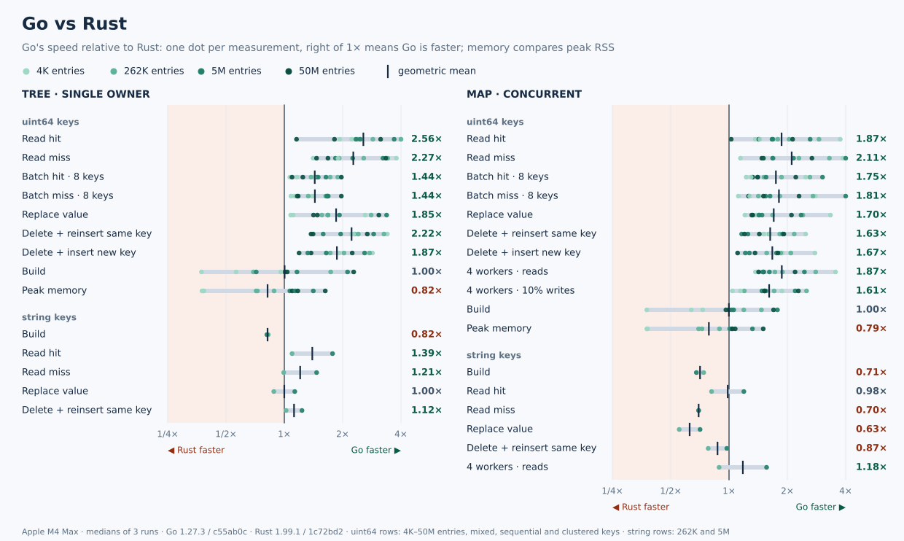

# gobbtree

**Fast ordered maps and sets for Go: a B+ tree that searches with SIMD.**

[](https://github.com/thesyncim/gobbtree/actions/workflows/test.yml)
[](https://github.com/thesyncim/gobbtree/actions/workflows/amd64-simd.yml)

A Go port of [XiangpengHao/bbtree](https://github.com/XiangpengHao/bbtree). Nodes keep compact inline summaries of their keys and search them with vector instructions, so most lookups never touch a full key.

- **Fast.** It beats the Rust original on most read, batch and churn workloads. [Benchmarks](#benchmarks) cover every workload, including the ones where Rust still wins.
- **Concurrent.** `Map` has lock-free lookups for numeric values and per-leaf locking everywhere else.
- **Any ordered key.** It supports every `cmp.Ordered` type, plus your own types through a two-method `Key` interface.
- **On disk.** Write a snapshot, then query it in place with `mmap`.
- **Pure Go.** No assembly, cgo or dependencies. SIMD comes from Go's `simd` package (Go 1.27).

## Quick start

```sh
go get github.com/thesyncim/gobbtree
```

```go
scores := gobbtree.New[uint64, string]() // concurrent; the zero value works too
scores.Insert(42, "answer")
scores.Insert(7, "lucky")

value, found := scores.Get(42) // "answer", true

for key, value := range scores.All() { // ascending: 7, then 42
    fmt.Println(key, value)
}

for key, value := range scores.Range(0, 10) { // keys in [0, 10)
    fmt.Println(key, value) // break stops early
}
```

Build with `GOEXPERIMENT=simd` to enable the vector search. Without it, the same code uses scalar search.

## Containers

| Type | Use it for |
|---|---|
| `Map[K, V]` · `New` | Concurrent readers and writers |
| `Tree[K, V]` · `NewTree` | A single owner; concurrent reads only while nobody writes |
| `Set[K]` · `NewSet` | A single-owner set with union, intersection, difference and subset tests |
| `MapOf`, `TreeOf`, `SetOf` | The same three containers, for [custom keys](#custom-keys) and `[]byte` keys (`Bytes`) |
| `FileMap[K, V]` | A read-only snapshot, searched in place on disk ([file maps](#file-maps)) |

All zero values are ready to use. Don't copy a container after first use.

| Operation | Returns |
|---|---|
| `Get(k)` · `Insert(k, v)` · `Delete(k)` | The value or previous value, and a found flag |
| `Take(k)` | Removes `k`, returning the stored key and value |
| `GetMany(keys, dst)` · `InsertMany(entries, dst)` | Per-key results, in caller-provided storage |
| `Range(lo, hi)` · `RangeReverse(lo, hi)` | Iterates `[lo, hi)`, ascending or descending |
| `Scan(b)` · `ScanReverse(b)` | Iterates any `Bounds`: `Between(a, b)`, `AtLeast(a).AtMost(b)`, `Above(a)`, `Below(b)`, … |
| `Ascend(from)` · `Descend(from)` | Iterates keys `>= from` ascending, or `<= from` descending |
| `All()` · `Reverse()`, plus `Keys()` · `Values()` on Tree | Iterates everything |
| `First()` · `Last()` · `PopFirst()` · `PopLast()` | The end entries |
| `Update` · `LoadOrStore` · `LoadOrStoreFunc` · `UpdateOrInsert` | Read-modify-write; atomic on `Map`. Callbacks receive the stored key |
| `UpdateRange(b, f)` · `UpdateAll(f)` · `InsertAll(seq)` | Bulk changes |
| `Read` · `ReadMany` · `UpdateOrInsertMany` · `DeleteIf` | Callback reads, batched upserts and conditional delete on `Map` |
| `LowerBound` · `UpperBound` · `SplitOff` · `Append` · `Retain` · `ExtractIf(b, f)` | Ordered editing on `Tree` |
| `Entry(k)` · `FirstEntry()` · `LastEntry()` | Upstream's entry API on `Tree`: `OrInsert`, `OrInsertWith`, `AndModify`, `Remove`, … |
| `Clone()` · `EqualFunc` · `CompareFunc` · `String()` · `Drain()` | Copy, compare, format and consume (`Equal`/`Compare` on `Set`) |

Iterators are Go range-over-func sequences: `break` stops them. `Set` offers the same iterators over keys, plus union, intersection, difference and subset tests; `FileMap` offers the read-only ones.

Keys follow `cmp.Compare`: NaN sorts first and `-0 == +0`. An equal key keeps the originally stored key. Keys and values are copied shallowly.

## Custom keys

Any type can be a key by implementing `Key`. `Compare` defines the order. `Window` exposes that order to the SIMD search.

```go
type Key[K any] interface {
    Compare(other K) int
    // Bytes offset..offset+8 of an encoding that sorts like Compare,
    // big-endian and zero past its end.
    Window(offset int) uint64
}
```

For example, to order names case-insensitively:

```go
type Tag string

func (t Tag) Compare(o Tag) int {
    return strings.Compare(strings.ToLower(string(t)), strings.ToLower(string(o)))
}

func (t Tag) Window(offset int) uint64 {
    return gobbtree.StringWindow(strings.ToLower(string(t)), offset)
}

tags := gobbtree.NewMapOf[Tag, int]()
tags.Insert("Go", 1)
tags.Insert("GO", 2) // same key: replaces the value, keeps "Go"
```

Byte-slice keys are built in as `gobbtree.Bytes`:

```go
index := gobbtree.NewMapOf[gobbtree.Bytes, int]()
buf := []byte("user:42")
index.Insert(buf, 1)     // stores a copy: buf may be reused
v, ok := index.Get(buf)  // lookups never allocate or retain buf
```

A key type whose values refer to reusable memory implements `Clone() K`, and containers store a clone of each new key. Equal keys must have equal windows.

A composite key encodes its fields one after another. For example, a `uint32` tenant becomes four big-endian bytes, followed by a name. `StringWindow`, `BytesWindow` and `Uint64Window` window the common encodings. Windows that tie are resolved by `Compare`, so even a constant `Window` is correct, just slower. This is the Go counterpart of upstream's `InlineKey` trait.

## Concurrency

A `Map` of word-sized keys and values (integers, floats, bools) shares one tree as upstream's `BBTreeMap` does ([design](https://github.com/XiangpengHao/bbtree/blob/1c72bd27994ed0a38694b029618e80115e22644f/design/09-concurrency.md)). Every node carries a latch word with a version. Lookups descend optimistically, checking each node's version after reading its child's, and write nothing. Writers latch only the leaf they change. A split or a merge takes, without waiting, only the nodes it changes, and starts over if another goroutine holds one. No lock, epoch or counter is shared by all writers, so writes scale with cores. A lookup whose leaf keeps changing takes the leaf's shared latch, so readers make progress behind a hot leaf. Freed nodes keep their latch word for life and come back only as nodes of their kind, so a stale pointer always fails its version check.

Beyond upstream, every node also keeps its fences, the bounds of the keys under it, and a table of hints jumps from a key straight to its leaf. A hint is never trusted: the leaf's version and fences are checked before it is used, and a stale one costs only a descent from the root. Lookups read with plain loads, ordered by address dependencies rather than acquire loads, so independent lookups overlap their cache misses; race-detector builds use atomic loads instead. A full leaf first moves entries to a sibling with room, as `Tree` does, so leaves stay about four-fifths full; an ascending run splits its leaf nearly full instead.

`Map`s of other keys or values (strings, `MapOf` custom keys, values wider than a word) run the same protocol over nodes of any key and value. A separator is a boxed key, never changed once boxed, so a racing descent compares it whole. Text keys route as upstream's do: the root keeps the prefix every key shares, and a query without it reads no node; an internal node's prefix is what its fences share, which every key under it has, so a descent skips it unchecked; and the node keeps a 4-byte summary of each separator past it, all 32 in one 128-byte line, comparing the boxed separators only where summaries tie. Upstream keeps no separator keys and latches the leaf whose head key settles a tie; a boxed key needs no latch. A text leaf keeps each key's next 16 bytes and length, so a key no longer than those settles within the leaf. A lookup reads its leaf without latching it when codes settle the key: integer and float keys, and text keys with a single candidate, whose key header and value it copies racing and uses only once the leaf's version holds. Upstream copies only `Copy` values that way; Go's collector keeps alive whatever a torn copy points at, and the copy is dropped unread, so any value can be. Other lookups, and custom keys, take the leaf's shared latch, as upstream does for keys it can't read inline. Freed nodes go to the collector, which keeps one alive while a stale pointer reaches it; its version, bumped as it is freed, fails that pointer's check.

- Iteration (`Scan`, `Range`, `Ascend`, `Descend`, `All`, their reverses, `First`, `Last`) keeps upstream's `range_cloned` contract, also for `Scan`: it copies a leaf at a time, under its shared latch, and visits the copy with nothing held, so the loop body may use the map. Upstream's `scan` instead runs its closure under each leaf's read latch, which holds back that leaf's writers and forbids writing the map from the closure. Iteration is not a snapshot: an entry present throughout is visited exactly once; entries inserted or removed meanwhile may or may not be.
- Each batch entry is consistent on its own; a batch is not a transaction.
- `Read`, `Update`, `UpdateOrInsert`, `DeleteIf` and `LoadOrStore` run under the entry's leaf latch, as upstream's do; their callbacks must not call back into the same map. A panicking callback releases its locks and stores nothing.
- As upstream's shared map, `Map` has no `Len`. `IsEmpty` reports whether the map held no entry at some moment during the call. `Clear`, like upstream's `clear(&mut self)`, is the owner's: no other goroutine may use the map until it returns.

## File maps

```go
if err := tree.WriteFile("index.bbt"); err != nil { ... }

disk, err := gobbtree.Mmap[string, int]("index.bbt").Open() // or ReadFile
if err != nil { ... }
defer disk.Close()
value, found := disk.Get("alpha")
```

A file map searches the image in place, with no rebuild. As upstream, `ReadFile`, `ReadFileRange` and `OpenFileMap` check every page; `Mmap(...).Open()` and `OpenFileMapUnchecked` check the header alone, so a corrupt file may give wrong answers or panic, but is never read out of bounds. It supports `Get`, `GetMany`, iteration in both directions and bounded scans. Files use upstream's version 1 format, which the Rust oracle tests in both directions.

- **Keys:** integer and string keys.
- **Values:** numbers, plain arrays, empty structs, strings and byte slices.
- **Writing:** `CreateFile` builds a file from an ascending `iter.Seq2`. `NewFileWriter`, `WriteAt`, `ReadFileRange` and `Mmap(...).Range` handle snapshots embedded in larger files; `Mmap(...).Pages(OsPagesHuge)` advises huge pages on Linux.
- **Immutability:** to change a file map, write a new snapshot; `WriteFile` replaces the file atomically.

## Coming from bbtree

The API follows upstream's operations with Go names; results are Go multi-value returns and iterators are range-over-func sequences.

| Upstream | gobbtree |
|---|---|
| `get` · `get_copied` · `get_cloned` · `contains_key` · `get_key_value` | `Get` · `Contains` · `GetKeyValue` |
| `insert` · `remove` · `remove_entry` | `Insert` · `Delete` · `Take` |
| `get_many_*` · `insert_many` · `read_many` · `update_or_insert_many` | `GetMany` · `InsertMany` · `ReadMany` · `UpdateOrInsertMany` |
| `read` · `update` · `update_or_insert` · `get_or_insert` · `remove_if` | `Read` · `Update` · `UpdateOrInsert` · `LoadOrStore` · `DeleteIf`; callbacks see the stored key, and a closure's result is captured by the closure |
| `get_mut` · `iter_mut` · `values_mut` · `range_mut` | `Update` · `UpdateAll` · `UpdateRange` |
| `entry` · `first_entry` · `last_entry` | `Entry` · `FirstEntry` · `LastEntry`, with `OrInsert` · `OrInsertWith` · `OrInsertWithKey` · `OrDefault` · `AndModify` · `Insert` · `InsertEntry` · `Remove` |
| Range bounds `a..b` · `a..=b` · `a..` · `..b` · `..=b` · `(Excluded(a), _)` | `Between(a, b)` · `AtLeast(a).AtMost(b)` · `AtLeast(a)` · `Below(b)` · `AtMost(b)` · `Above(a)…`; invalid bounds panic as upstream's do |
| `iter` · `range` · `range_cloned` · `scan` · `scan_rev` | `All` / `Reverse` · `Scan` / `ScanReverse` (any `Bounds`) · `Range` / `RangeReverse` / `Ascend` / `Descend` |
| `keys` · `values` · `first_key_value` · `last_key_value` · `first_copied` · `pop_first` · `pop_last` | `Keys` · `Values` · `First` · `Last` · `FirstIn` · `PopFirst` · `PopLast` |
| `retain` · `extract_if` · `split_off` · `append` · `Extend` · `FromIterator` | `Retain` · `ExtractIf` · `SplitOff` · `Append` · `InsertAll` |
| set `contains_many` · `replace` · `take` · `union` · `intersection` · `difference` · `symmetric_difference` · `is_subset` | the same names on `Set` |
| `Clone` · `PartialEq`/`Eq` · `PartialOrd`/`Ord` · `Debug` · `into_iter`/`into_keys`/`into_values` | `Clone` · `EqualFunc`/`Equal` · `CompareFunc`/`Compare` · `String` · `Drain` |
| `InlineKey` (`inline_key_at`) · byte-string keys, which compare from where they differ (`cmp_from`) | `Key` (`Window`) · `Bytes`; string and `Bytes` keys compare from where they differ |
| `FileMap` · `FileWriter::from_ascending` | `FileMap` · `NewFileWriter` / `CreateFile` |
| `FileMap::open` · `open_unchecked` · `NotAscending::index` | `OpenFileMap` · `OpenFileMapUnchecked` · `NotAscendingError.Index` |
| bbtree-mmap `create` · `write_at` · `read` · `read_range` · `mmap().range().pages().open()` | `CreateFile` · `WriteAt` · `ReadFile` · `ReadFileRange` · `Mmap().Range().Pages().Open()` |

Not carried over, because Go has no counterpart:
- **References into the map.** Go takes values out and puts them back (the `Update` family and `Entry`), so `get_mut`, `iter_mut` and `range_mut` become `Update`, `UpdateAll` and `UpdateRange`.
- **Rust-only traits.** There is no operator overloading for `Index` (use `Get`) and no `Hash` trait.
- **Allocators and `InsertError`.** Go's allocation failure is fatal, so `Insert` has no error path.
- **`NodeConfig` page sizes.** Nodes hold a fixed 32 entries. Go generics can index an array type parameter but cannot slice it or point into it, which shifting entries and the SIMD searches do, so another size would mean another copy of the node code.
- **The rest of `InlineKey`:** `WIDTH`, `hash_tag`, `cmp_prefix`, and `cmp_from` on custom keys. These tune upstream's node layout, and a generic Go container cannot call an optional key method without boxing the key.
- **Leaf annexes and their `*_with_leaf` methods.** They let `bbtree-store` manage manually allocated pages, which Go's garbage collector manages here.
- **The `inspect` and `check_invariants` debugging helpers.**

Additions beyond upstream:
- **`Map`:** `First`, `Last`, `PopFirst`, `PopLast`, `LoadOrStoreFunc`, `UpdateAll`, `UpdateRange`, `WriteFile`, `Ascend` and `Descend`.
- **`Tree`:** `LowerBound`, `UpperBound`, `LoadOrStore`, `LoadOrStoreFunc` and `UpdateOrInsert`.
- **`FileMap`:** `ByteLen`, `WriteTo`, `Close`, `Ascend`, `Descend`, `Reverse` and `RangeReverse`.
- **Everywhere:** `Range(lo, hi)` as shorthand for `Scan(Between(lo, hi))`.

## SIMD

| Target | Search kernels |
|---|---|
| amd64 | AVX-512 or AVX2, with a 128-bit fallback |
| arm64 | NEON |
| Others | Portable Go SIMD where available, otherwise scalar |

The kernel is chosen at run time. `gobbtree.SIMD()` reports the choice, and `GODEBUG=simd=0` forces the scalar path.

## Benchmarks

Go 1.27.3 with `GOEXPERIMENT=simd` against the Rust original (1.99.1, native CPU tuning, full LTO, mimalloc) on an Apple M4 Max, from [Go `c55ab0c`](https://github.com/thesyncim/gobbtree/commit/c55ab0c8f7a943599570bade089bae583d719081) and [Rust `1c72bd2`](https://github.com/XiangpengHao/bbtree/tree/1c72bd27994ed0a38694b029618e80115e22644f): medians of three fresh-process runs over identical datasets, with checked results.



Each dot is one measurement; `uint64` rows cover 4K to 50M entries with mixed keys (hashed keys spread over the full 64-bit range), sequential keys (consecutive even keys; misses and fresh keys fill the gaps), clustered keys (runs of 1,024 consecutive even keys at scattered bases). Batches are per key, churn is one deletion and one insertion, and parallel rows use four workers. Memory is whole-process peak RSS, including the Go runtime and GC headroom.

<details>
<summary>Times, mixed keys — Go / Rust, ns/op</summary>

**Tree**

| Workload | 4K | 262K | 5M | 50M |
|---|---:|---:|---:|---:|
| Read hit | 6.82 / 13.19 | 10.05 / 23.98 | 34.23 / 84.33 | 71.23 / 129.28 |
| Read miss | 8.66 / 12.20 | 12.13 / 23.28 | 40.71 / 74.76 | 80.26 / 117.71 |
| Batch hit · 8 keys | 11.72 / 12.52 | 12.88 / 24.32 | 34.24 / 51.24 | 69.40 / 76.06 |
| Batch miss · 8 keys | 11.37 / 12.30 | 12.79 / 20.92 | 25.83 / 42.81 | 55.64 / 65.64 |
| Replace value | 12.28 / 13.26 | 17.21 / 26.89 | 52.09 / 87.46 | 98.17 / 138.91 |
| Delete + reinsert same key | 34.84 / 77.53 | 51.54 / 119.04 | 127.78 / 249.71 | 263.11 / 370.27 |
| Delete + insert new key | 61.51 / 101.53 | 89.37 / 154.30 | 222.58 / 366.35 | 423.05 / 581.11 |

**Map**

| Workload | 4K | 262K | 5M | 50M |
|---|---:|---:|---:|---:|
| Read hit | 10.36 / 14.16 | 16.59 / 29.57 | 58.78 / 98.94 | 99.21 / 141.46 |
| Read miss | 11.17 / 12.79 | 15.40 / 26.03 | 41.24 / 69.23 | 83.98 / 124.02 |
| Batch hit · 8 keys | 11.43 / 14.02 | 15.06 / 22.81 | 36.39 / 51.14 | 57.67 / 76.38 |
| Batch miss · 8 keys | 11.87 / 13.26 | 14.05 / 19.91 | 29.43 / 45.41 | 51.24 / 64.60 |
| Replace value | 12.28 / 14.83 | 22.10 / 31.76 | 85.17 / 126.02 | 128.41 / 168.16 |
| Delete + reinsert same key | 51.83 / 78.39 | 70.51 / 113.60 | 226.59 / 263.41 | 291.70 / 418.16 |
| Delete + insert new key | 57.73 / 108.68 | 95.82 / 149.87 | 314.35 / 381.66 | 464.83 / 633.18 |
| 4 workers · reads | 2.79 / 4.20 | 4.36 / 7.53 | 17.57 / 28.38 | 25.52 / 38.48 |
| 4 workers · 10% writes | 7.11 / 7.40 | 7.76 / 9.30 | 18.85 / 29.21 | 26.94 / 41.03 |

</details>

<details>
<summary>Times, sequential keys — Go / Rust, ns/op</summary>

**Tree**

| Workload | 4K | 262K | 5M | 50M |
|---|---:|---:|---:|---:|
| Read hit | 5.39 / 11.99 | 8.50 / 24.36 | 38.37 / 89.86 | 86.76 / 100.28 |
| Read miss | 5.89 / 11.14 | 8.72 / 22.41 | 29.71 / 66.93 | 56.91 / 95.55 |
| Batch hit · 8 keys | 10.27 / 11.93 | 12.89 / 22.24 | 36.06 / 53.18 | 56.97 / 71.01 |
| Batch miss · 8 keys | 9.88 / 11.17 | 12.03 / 20.10 | 23.37 / 38.96 | 49.79 / 58.04 |
| Replace value | 11.31 / 12.55 | 15.48 / 25.95 | 52.80 / 101.63 | 91.30 / 135.19 |
| Delete + reinsert same key | 34.88 / 79.53 | 51.59 / 124.30 | 167.21 / 265.45 | 241.31 / 331.54 |
| Delete + insert new key | 34.36 / 65.71 | 58.13 / 118.13 | 206.65 / 273.17 | 272.78 / 325.13 |

**Map**

| Workload | 4K | 262K | 5M | 50M |
|---|---:|---:|---:|---:|
| Read hit | 9.39 / 13.54 | 14.25 / 29.11 | 63.69 / 106.14 | 113.79 / 116.76 |
| Read miss | 8.39 / 12.73 | 11.54 / 26.49 | 30.14 / 64.83 | 69.34 / 104.22 |
| Batch hit · 8 keys | 10.64 / 13.84 | 12.37 / 23.09 | 34.50 / 53.57 | 51.27 / 72.07 |
| Batch miss · 8 keys | 10.20 / 13.05 | 11.24 / 20.56 | 23.74 / 38.64 | 40.09 / 60.40 |
| Replace value | 11.06 / 15.31 | 19.38 / 32.50 | 85.76 / 122.22 | 121.90 / 161.77 |
| Delete + reinsert same key | 50.07 / 81.06 | 67.54 / 123.37 | 203.76 / 255.02 | 276.01 / 332.09 |
| Delete + insert new key | 41.61 / 86.30 | 61.85 / 114.33 | 211.00 / 268.76 | 286.30 / 316.94 |
| 4 workers · reads | 2.50 / 3.43 | 3.90 / 7.36 | 17.43 / 26.04 | 25.20 / 35.82 |
| 4 workers · 10% writes | 6.04 / 6.91 | 5.32 / 9.09 | 19.05 / 28.16 | 26.45 / 40.31 |

</details>

<details>
<summary>Times, clustered keys — Go / Rust, ns/op</summary>

**Tree**

| Workload | 4K | 262K | 5M | 50M |
|---|---:|---:|---:|---:|
| Read hit | 5.84 / 26.81 | 11.64 / 48.29 | 44.03 / 162.44 | 108.39 / 340.39 |
| Read miss | 6.60 / 24.99 | 13.23 / 45.22 | 43.42 / 140.31 | 99.63 / 333.13 |
| Batch hit · 8 keys | 16.98 / 24.11 | 31.27 / 42.96 | 76.28 / 125.14 | 105.87 / 208.60 |
| Batch miss · 8 keys | 17.06 / 23.77 | 31.52 / 41.90 | 67.02 / 112.97 | 101.52 / 199.94 |
| Replace value | 10.81 / 28.25 | 18.50 / 51.95 | 59.58 / 200.97 | 130.82 / 402.21 |
| Delete + reinsert same key | 35.16 / 119.63 | 54.03 / 176.59 | 151.90 / 439.24 | 283.02 / 758.51 |
| Delete + insert new key | 36.43 / 103.85 | 63.25 / 174.29 | 186.45 / 484.16 | 330.33 / 740.40 |

**Map**

| Workload | 4K | 262K | 5M | 50M |
|---|---:|---:|---:|---:|
| Read hit | 9.87 / 37.02 | 21.64 / 63.03 | 76.54 / 200.70 | 169.57 / 361.03 |
| Read miss | 8.87 / 34.29 | 18.31 / 60.34 | 44.47 / 183.22 | 126.10 / 337.69 |
| Batch hit · 8 keys | 10.90 / 27.06 | 18.72 / 48.98 | 50.49 / 153.43 | 112.43 / 248.58 |
| Batch miss · 8 keys | 10.38 / 28.97 | 17.71 / 48.01 | 35.78 / 143.37 | 103.65 / 238.21 |
| Replace value | 11.57 / 38.64 | 26.35 / 63.34 | 88.40 / 208.06 | 179.23 / 376.36 |
| Delete + reinsert same key | 50.57 / 125.76 | 74.82 / 162.38 | 211.59 / 400.23 | 333.94 / 640.53 |
| Delete + insert new key | 43.99 / 122.04 | 78.92 / 164.58 | 222.83 / 391.91 | 358.66 / 641.77 |
| 4 workers · reads | 2.67 / 9.46 | 5.75 / 16.10 | 21.57 / 52.83 | 41.64 / 91.27 |
| 4 workers · 10% writes | 5.15 / 9.65 | 6.70 / 16.83 | 24.63 / 54.07 | 42.23 / 96.26 |

</details>

<details>
<summary>Memory and build — Go / Rust</summary>

**Mixed keys**

| Container | Entries | Peak RSS, MB | After reads, MB | Collected / settled RSS, MB | Build, seconds |
|---|---:|---:|---:|---:|---:|
| Tree | 4K | 5.60 / 2.15 | 4.78 / 2.13 | 5.60 / 2.13 | 0.0005 / 0.0002 |
| Tree | 262K | 12.65 / 9.04 | 12.57 / 9.03 | 12.65 / 9.03 | 0.0278 / 0.0285 |
| Tree | 5M | 127.78 / 136.46 | 127.73 / 136.45 | 127.78 / 136.45 | 0.5429 / 0.6311 |
| Tree | 50M | 1,225.92 / 1,347.80 | 1,225.87 / 1,347.78 | 1,225.92 / 1,347.78 | 10.3872 / 10.4440 |
| Map | 4K | 5.69 / 2.15 | 4.88 / 2.13 | 5.69 / 2.13 | 0.0006 / 0.0004 |
| Map | 262K | 12.47 / 9.04 | 12.14 / 9.03 | 12.47 / 9.03 | 0.0286 / 0.0287 |
| Map | 5M | 132.51 / 136.50 | 132.48 / 136.48 | 132.51 / 136.48 | 0.6027 / 0.6369 |
| Map | 50M | 1,252.67 / 1,348.19 | 1,252.56 / 1,348.17 | 1,252.67 / 1,348.17 | 10.7269 / 10.6927 |

**Sequential keys**

| Container | Entries | Peak RSS, MB | After reads, MB | Collected / settled RSS, MB | Build, seconds |
|---|---:|---:|---:|---:|---:|
| Tree | 4K | 5.59 / 2.15 | 4.72 / 2.13 | 5.59 / 2.13 | 0.0000 / 0.0000 |
| Tree | 262K | 11.34 / 8.24 | 10.94 / 8.22 | 11.34 / 8.22 | 0.0036 / 0.0025 |
| Tree | 5M | 105.69 / 120.23 | 105.66 / 120.21 | 105.69 / 120.21 | 0.0496 / 0.0356 |
| Tree | 50M | 1,008.94 / 1,184.01 | 1,008.91 / 1,183.99 | 1,008.94 / 1,183.99 | 0.3972 / 0.4114 |
| Map | 4K | 5.65 / 2.15 | 4.80 / 2.13 | 5.65 / 2.13 | 0.0001 / 0.0000 |
| Map | 262K | 11.83 / 8.24 | 11.44 / 8.22 | 11.83 / 8.22 | 0.0037 / 0.0044 |
| Map | 5M | 119.28 / 120.27 | 119.21 / 120.26 | 119.28 / 120.26 | 0.0578 / 0.0597 |
| Map | 50M | 1,136.90 / 1,184.46 | 1,136.74 / 1,184.45 | 1,136.90 / 1,184.45 | 0.5368 / 0.5172 |

**Clustered keys**

| Container | Entries | Peak RSS, MB | After reads, MB | Collected / settled RSS, MB | Build, seconds |
|---|---:|---:|---:|---:|---:|
| Tree | 4K | 5.75 / 2.16 | 4.87 / 2.15 | 5.75 / 2.15 | 0.0002 / 0.0002 |
| Tree | 262K | 13.19 / 11.68 | 13.06 / 11.67 | 13.19 / 11.67 | 0.0159 / 0.0276 |
| Tree | 5M | 132.58 / 187.07 | 132.55 / 187.06 | 132.58 / 187.06 | 0.1889 / 0.4003 |
| Tree | 50M | 1,138.98 / 1,853.28 | 1,138.95 / 1,853.26 | 1,138.98 / 1,853.26 | 1.8260 / 4.1662 |
| Map | 4K | 5.73 / 2.16 | 4.92 / 2.15 | 5.73 / 2.15 | 0.0002 / 0.0002 |
| Map | 262K | 13.09 / 11.68 | 12.96 / 11.67 | 13.09 / 11.67 | 0.0176 / 0.0259 |
| Map | 5M | 141.59 / 187.07 | 141.54 / 187.06 | 141.59 / 187.06 | 0.2145 / 0.3813 |
| Map | 50M | 1,234.19 / 1,853.31 | 1,234.16 / 1,853.29 | 1,234.19 / 1,853.29 | 2.3823 / 4.0440 |

</details>

<details>
<summary>String keys — Go / Rust, ns/op</summary>

`string` keys against Rust's `String`, each mixed key written as `user:` and 16 hex digits, with `uint64` values. Rust's containers move in keys made beforehand; Go's copy each key's bytes into their leaves, in buffers the collector doesn't scan. Rust replaces values with `update` and `get_mut`, and its churn inserts back the key its removal returned.

| Workload | 262K | 5M |
|---|---:|---:|
| Tree · Build, per insert | 115.5 / 95.4 (+21%) | 240.8 / 195.7 (+23%) |
| Tree · Read hit | 36.2 / 39.7 (-9%) | 102.5 / 181.8 (-44%) |
| Tree · Read miss | 33.3 / 33.0 (+1%) | 82.3 / 120.8 (-32%) |
| Tree · Replace value | 46.5 / 41.0 (+13%) | 158.2 / 179.2 (-12%) |
| Tree · Delete + reinsert same key | 143.7 / 146.8 (-2%) | 319.1 / 393.6 (-19%) |
| Map · Build, per insert | 141.8 / 104.9 (+35%) | 313.9 / 212.9 (+47%) |
| Map · Read hit | 54.5 / 44.3 (+23%) | 141.5 / 168.9 (-16%) |
| Map · Read miss | 50.0 / 34.8 (+44%) | 131.6 / 91.8 (+43%) |
| Map · Replace value | 87.7 / 48.5 (+81%) | 249.1 / 176.5 (+41%) |
| Map · Delete + reinsert same key | 193.9 / 151.4 (+28%) | 410.6 / 399.9 (+3%) |
| Map · 4 workers · reads | 13.9 / 12.4 (+13%) | 39.4 / 61.5 (-36%) |

</details>

Small gaps are within run-to-run noise. The [raw report](benchmarks/arm64-2026-10-29.json) adds Go's built-in `map` and `sync.Map`; amd64 results are [CI artifacts](https://github.com/thesyncim/gobbtree/actions/workflows/amd64-simd.yml).

## Reproducing the benchmarks

<details>
<summary>Build the drivers and run the comparisons, from source checkpoint `c55ab0c`</summary>

```sh
GOEXPERIMENT=simd go build -o compare-go ./cmd/compare
GOEXPERIMENT=simd go build -o memory-go ./cmd/memory
RUSTFLAGS='-C target-cpu=native' cargo build --release --locked \
  --manifest-path internal/oracle/Cargo.toml --bin compare --bin memory
```

Run the CPU comparison (shown for 50M entries; for 4K and 262K use `--queries 8192 --rounds 512`):

```sh
python3 internal/cpu_compare.py --go ./compare-go --rust internal/oracle/target/release/compare \
  --size 50000000 --queries 1048576 --rounds 4 --threads 4 --repeat 3 --mutations --distinct
```

Then the memory and construction comparison:

```sh
python3 internal/rss_compare.py --go ./memory-go --rust internal/oracle/target/release/memory \
  --size 50000000 --repeat 3 --kinds tree map
```

Both scripts take `--keys mixed` (the default), `--keys sequential` or `--keys clustered`; the chart covers all three. `cpu_compare.py --text --mutations` runs the string-keyed cells, at 262K and 5M entries. `python3 internal/render_benchmarks.py` regenerates the chart and the tables above from the saved report.

</details>

How the comparison is kept fair:

- **Identical work.** Both languages get identical keys, queries and operation counts. Checksums are verified, including every bit of replaced values. Different-key churn uses disjoint key sets and checks that every delete and insert succeeds.
- **Several key distributions.** Each workload runs on hashed keys spread across the full 64-bit range, on consecutive keys, and on clustered runs of consecutive keys, so no result rests on one distribution.
- **Fresh processes.** Every backend runs in a fresh process, in rotated order. Serial cases are pinned to one OS thread. Parallel timings exclude starting workers and reducing checksums.
- **Public APIs.** Batches go through each library's public batch API, and the Rust code is unmodified upstream.
- **Equal guarantees.** Both concurrent maps omit `len()`, and both read payloads with plain loads validated by node versions ([design](https://github.com/XiangpengHao/bbtree/blob/1c72bd27994ed0a38694b029618e80115e22644f/design/09-concurrency.md)).
- **Whole-process memory.** Memory is RSS of a process holding one container, measured after a full read pass, with Go's default GC settings.

`--standard` adds Go's built-in `map` and `sync.Map`.

## Testing

```sh
GOEXPERIMENT=simd go test -race ./...
GOEXPERIMENT=simd GODEBUG=simd=0 go test ./...
GOEXPERIMENT=simd go test -run '^$' -fuzz FuzzTree -fuzztime 20s
```

The tests check every container against independent references:

- randomized operation sequences with tree invariants;
- concurrent mutation and callback panics;
- SIMD boundaries and steady-state allocations;
- custom key orders.

CI also runs a live Rust oracle for containers and file interoperability, against upstream pinned at [`1c72bd2`](https://github.com/XiangpengHao/bbtree/tree/1c72bd27994ed0a38694b029618e80115e22644f).

Licensed under **MIT OR Apache-2.0**, like upstream. See [LICENSE](LICENSE).
