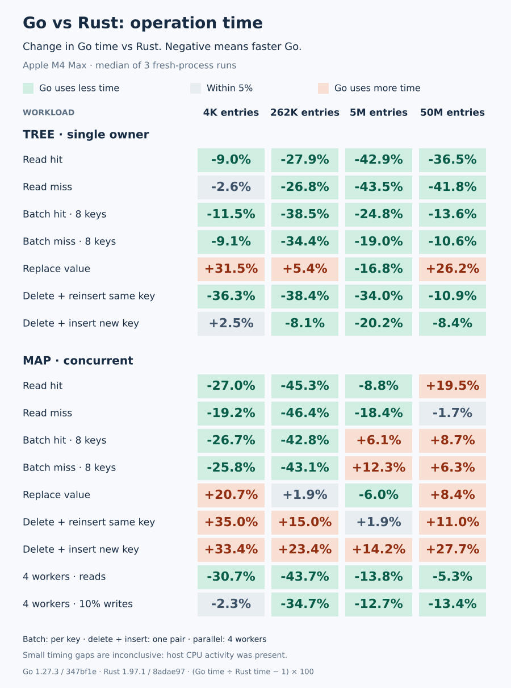
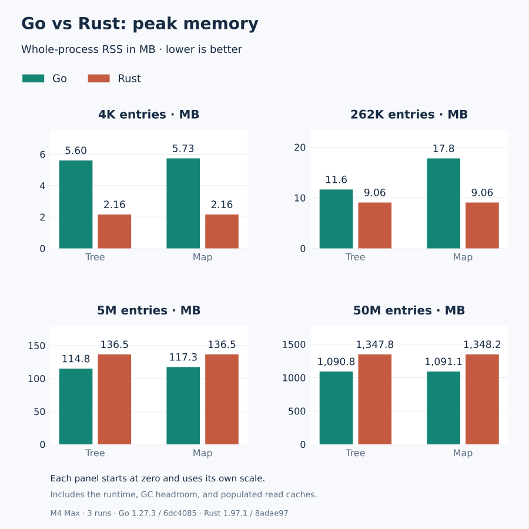
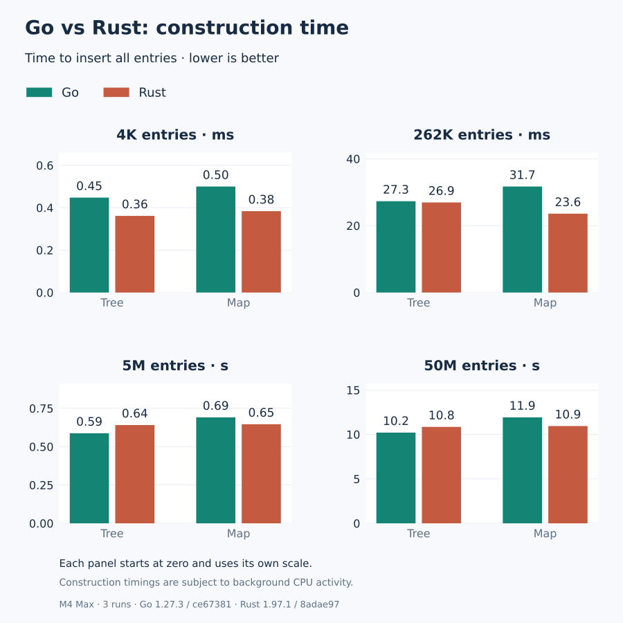

# gobbtree

**Ordered maps and sets for Go, with SIMD search and range scans.**

A Go port of [XiangpengHao/bbtree](https://github.com/XiangpengHao/bbtree), built for **Go 1.27.x**. Generic keys and values, a concurrent map, a single-owner tree and set, and read-only file maps. Pure Go: no handwritten assembly, cgo, or external runtime dependencies.

[](https://github.com/thesyncim/gobbtree/actions/workflows/test.yml)
[](https://github.com/thesyncim/gobbtree/actions/workflows/amd64-simd.yml)

## Quick start

```sh
go get github.com/thesyncim/gobbtree
```

```go
package main

import (
    "fmt"

    "github.com/thesyncim/gobbtree"
)

func main() {
    scores := gobbtree.New[uint64, string]()
    scores.Insert(42, "answer")
    scores.Insert(7, "lucky")

    if value, found := scores.Get(42); found {
        fmt.Println(value) // answer
    }

    // Visit keys in [0, 100), in ascending order.
    scores.Scan(0, 100, func(key uint64, value string) bool {
        fmt.Println(key, value) // 7 lucky, then 42 answer
        return true            // return false to stop
    })
}
```

Enable Go SIMD when building or running your application:

```sh
GOEXPERIMENT=simd go run .
```

## Choose your container

| | `Tree[K, V]` | `Map[K, V]` |
|---|---|---|
| Constructor | `NewTree[K, V]()` | `New[K, V]()` |
| Access | One owner; concurrent reads when there are no writes | Concurrent readers and writers |
| Ordered iteration | Forward, reverse, and bounded scans | Forward iteration and bounded scans in either direction |
| Copy | `Clone()` | Consistent `Snapshot()` |
| Conditional updates | `Update`, `LoadOrStore` | `Update`, `UpdateOrInsert`, `LoadOrStore`, `DeleteIf` |

Both zero values are ready to use. Keys support Go's ordered types, including strings and defined numeric types; values can be any type. Do not copy a container after first use.

`NewSet[K]()` provides the single-owner ordered set from upstream: insertion, removal, batch membership, range scans, union, intersection, difference, and subset checks. It also supports cloning, splitting, appending, filtering and file snapshots. `Tree` offers `LowerBound`, `UpperBound`, `GetKeyValue`, `SplitOff`, `Append`, `Retain`, and lazy `ExtractIf`.

## Core operations

| Operation | Result |
|---|---|
| `Get(key)` | Value and presence flag |
| `Insert(key, value)` | Previous value and replacement flag |
| `Delete(key)` | Removed value and presence flag |
| `GetMany(keys, dst)` / `InsertMany(entries, dst)` | Results in input order, using caller-provided storage |
| `Scan(lower, upper, visit)` / `ScanReverse(...)` | Ordered traversal of `[lower, upper)` |
| `First()` / `Last()` | Smallest or largest key and its value |
| `PopFirst()` / `PopLast()` | Remove and return an end entry |
| `Len()` / `IsEmpty()` / `Clear()` | Size and reset |

`All()` works with Go's range-over-function syntax. `Tree` also offers `Reverse()`:

```go
tree := gobbtree.NewTree[string, int]()
tree.Insert("alpha", 1)
tree.Insert("beta", 2)

for key, value := range tree.All() {
    fmt.Println(key, value)
}
```

Ordering follows `cmp.Compare`: NaNs sort before other floating-point values, and signed zeros compare equal. Equal keys retain the original stored key. Keys and values are shallow copies.

### Concurrency

`Map` uses optimistic reads for built-in primitive word values and leaf read locks for other values. Writers lock leaves independently; structural changes coordinate splits and merges.

- Scans are ordered and weakly consistent during concurrent writes. Use `Snapshot()` for a consistent copy of the entries.
- Batch entries are individually consistent; a batch is not a transaction.
- Callbacks run under locks and must not reenter the same map. A callback panic releases locks; update callbacks store their result only after returning.
- Synchronizing a map does not synchronize mutable objects referenced by its values.

Do not modify a `Tree` while iterating over it.

## File maps

Write a snapshot, then query its pages directly from disk:

```go
if err := tree.WriteFile("index.bbt"); err != nil {
    panic(err)
}
disk, err := gobbtree.MmapFile[string, int]("index.bbt")
if err != nil {
    panic(err)
}
defer disk.Close()
value, found := disk.Get("alpha")
```

`ReadFile` loads the same pages into owned memory. Both paths validate the image and search it in place, without reconstructing a `Tree`. File maps support `GetMany`, `GetKeyValue`, forward and reverse iteration, and bounded scans. Returned values remain valid after `Close`.

Files use the pinned Rust reference's version 1 format, checked in both directions by the Rust oracle. Integer and string keys, and numeric, plain-array, empty-struct, string and byte-slice values are supported on 64-bit targets. Match the Rust key/value types and platform layout; Go strings use Rust's `VarBytes` representation. Floating-point keys, pointer types, and nonempty structs are rejected. `mmap` is available on Linux, macOS and the BSDs; `ReadFile` also works elsewhere.

`CreateFile(path, entries)` accepts an ascending `iter.Seq2`. `NewFileWriter` builds a reusable image; `WriteAt`, `ReadFileRange`, and `MmapFileRange` support embedded snapshots. `WriteFile` publishes a complete replacement by rename. A file map is immutable: publish a new snapshot to change it, and do not modify or truncate a mapped file.

## SIMD, written in Go

| Architecture | Search kernels |
|---|---|
| amd64 | AVX2 and AVX-512, with a 128-bit fallback |
| arm64 | 128-bit NEON |
| Other targets | Portable Go SIMD where available; scalar fallback |

Kernels use Go's `simd` and `simd/archsimd` APIs. Runtime CPU checks select a supported path; `gobbtree.SIMD()` returns the selected hardware status and width. A normal build works without the SIMD experiment. `GODEBUG=simd=0` selects the scalar fallback for validation.

## Benchmarks

Apple M4 Max (ARM64), Go 1.27.3 with Go SIMD, and Rust 1.97.1 with native CPU tuning, full LTO, and mimalloc. Measured sources: [Go `347bf1e`](https://github.com/thesyncim/gobbtree/commit/347bf1e1be23d08936f3ece8dc93b2501f8534ce) and [Rust `8adae97`](https://github.com/XiangpengHao/bbtree/tree/8adae97a0ed97e5c98fa2790312eb0aec9719846). Timings and memory figures are medians of three fresh-process runs using identical datasets and checked results. 4K and 262K denote 4,096 and 262,144 entries.

### Operation time



Each cell shows the **percentage change in Go time versus Rust**. Negative means faster Go; positive means slower Go. Gray cells are within 5%. Batch timings are per key. Churn timings cover one deletion and one insertion; the two rows distinguish reinserting the same key from inserting a different key. Different-key churn uses unique keys spread throughout the tree and checks that every deletion succeeds and every insertion adds a new key. Parallel cases use four workers; the mixed case replaces existing values on 10% of operations.

<details>
<summary>Exact timings — Go / Rust, ns/op; lower is better</summary>

**Tree**

| Workload | 4K | 262K | 5M | 50M |
|---|---:|---:|---:|---:|
| Read hit | 10.44 / 11.47 | 15.80 / 21.91 | 44.81 / 78.47 | 74.35 / 117.11 |
| Read miss | 10.62 / 10.90 | 15.05 / 20.56 | 34.99 / 61.95 | 60.60 / 104.11 |
| Batch hit · 8 keys | 10.30 / 11.64 | 13.75 / 22.34 | 36.89 / 49.04 | 56.94 / 65.92 |
| Batch miss · 8 keys | 10.29 / 11.32 | 13.18 / 20.09 | 30.54 / 37.70 | 49.09 / 54.89 |
| Replace value | 16.37 / 12.45 | 26.56 / 25.21 | 67.08 / 80.60 | 147.00 / 116.47 |
| Delete + reinsert same key | 43.48 / 68.21 | 65.02 / 105.60 | 145.11 / 219.73 | 264.45 / 296.81 |
| Delete + insert new key | 90.62 / 88.40 | 122.78 / 133.68 | 259.37 / 325.04 | 434.73 / 474.70 |

**Map**

| Workload | 4K | 262K | 5M | 50M |
|---|---:|---:|---:|---:|
| Read hit | 9.37 / 12.83 | 13.78 / 25.17 | 70.70 / 77.50 | 118.83 / 99.44 |
| Read miss | 9.47 / 11.73 | 12.29 / 22.92 | 47.20 / 57.85 | 88.05 / 89.58 |
| Batch hit · 8 keys | 9.31 / 12.70 | 12.91 / 22.59 | 53.02 / 49.98 | 73.24 / 67.36 |
| Batch miss · 8 keys | 8.83 / 11.90 | 11.43 / 20.09 | 43.85 / 39.05 | 59.34 / 55.85 |
| Replace value | 17.13 / 14.19 | 28.78 / 28.25 | 87.98 / 93.58 | 151.72 / 139.97 |
| Delete + reinsert same key | 94.28 / 69.82 | 116.67 / 101.43 | 223.46 / 219.20 | 345.63 / 311.44 |
| Delete + insert new key | 125.26 / 93.89 | 160.53 / 130.06 | 366.27 / 320.73 | 606.04 / 474.63 |
| 4 workers · reads | 2.57 / 3.71 | 3.91 / 6.94 | 19.65 / 22.79 | 30.71 / 32.44 |
| 4 workers · 10% writes | 4.69 / 4.79 | 4.48 / 6.87 | 21.57 / 24.72 | 32.72 / 37.77 |

</details>

### Memory and construction



Memory includes each process’s runtime, allocator, GC headroom, and caches populated by a full read pass. Go uses its default GC settings. MB are decimal.



Construction measures inserting all entries into an empty container. Small cases use milliseconds; large cases use seconds.

<details>
<summary>Memory and build measurements — each cell is Go / Rust</summary>

| Container | Entries | Peak RSS, MB | After reads, MB | Collected / settled RSS, MB | Build, seconds |
|---|---:|---:|---:|---:|---:|
| Tree | 4K | 5.60 / 2.15 | 4.75 / 2.13 | 5.60 / 2.13 | 0.0009 / 0.0004 |
| Tree | 262K | 11.73 / 9.03 | 11.17 / 9.01 | 11.73 / 9.01 | 0.0396 / 0.0284 |
| Tree | 5M | 114.84 / 136.45 | 114.79 / 136.43 | 114.84 / 136.43 | 0.7498 / 0.6364 |
| Tree | 50M | 1,090.85 / 1,347.78 | 1,090.78 / 1,347.76 | 1,090.85 / 1,347.76 | 12.3598 / 10.3204 |
| Map | 4K | 5.70 / 2.15 | 4.82 / 2.13 | 5.70 / 2.13 | 0.0011 / 0.0004 |
| Map | 262K | 17.94 / 9.03 | 17.79 / 9.01 | 17.94 / 9.01 | 0.0457 / 0.0285 |
| Map | 5M | 117.42 / 136.48 | 117.31 / 136.46 | 117.42 / 136.46 | 0.9332 / 0.6431 |
| Map | 50M | 1,091.22 / 1,348.17 | 1,091.17 / 1,348.16 | 1,091.22 / 1,348.16 | 14.9003 / 10.3542 |

</details>

Background CPU activity was observed on the host; small timing gaps are inconclusive. These are ARM64 measurements. Native amd64 results are available as [CI artifacts](https://github.com/thesyncim/gobbtree/actions/workflows/amd64-simd.yml). The [raw report](benchmarks/arm64-2026-10-26.json) also includes Go’s built-in `map` and `sync.Map` CPU comparisons through 5M entries.

## Reproduce the comparisons

Performance work compares the Go implementation with a pinned, optimized Rust build, plus Go's built-in `map` and `sync.Map`. Results depend on the workload, entry count, CPU, and concurrency level.

To reproduce the recorded results, use source checkpoint `347bf1e` in a separate checkout. Build the drivers from its repository root:

```sh
GOEXPERIMENT=simd go build -o compare-go ./cmd/compare
GOEXPERIMENT=simd go build -o memory-go ./cmd/memory
RUSTFLAGS='-C target-cpu=native' cargo build --release --locked \
  --manifest-path internal/oracle/Cargo.toml --bin compare --bin memory
```

Run the **50-million-entry** CPU comparison:

```sh
python3 internal/cpu_compare.py \
  --go ./compare-go --rust internal/oracle/target/release/compare \
  --size 50000000 --queries 1048576 --rounds 4 --threads 4 --repeat 3 \
  --mutations --distinct
```

Each backend runs in a fresh process. The drivers use `uint64`/`u64` keys and values. Rust uses the pinned upstream benchmark’s mimalloc allocator, full LTO, and native CPU tuning; Go uses its normal allocator and GC settings.

For these numeric workloads, Go maintains an exact `Len` counter and uses atomic payload accesses after readers activate. Rust omits `len` and [documents racing plain reads](https://github.com/XiangpengHao/bbtree/blob/8adae97a0ed97e5c98fa2790312eb0aec9719846/design/09-concurrency.md#L296-L303) during optimistic lookups. The pinned Rust implementation is benchmarked unchanged.

Go and Rust receive identical keys, query streams, and operation counts; the driver checks checksums and rotates execution order. Eight-key batches use each library’s public batch API.

`--mutations` includes existing-key replacements and same-key delete/reinsert pairs after the read cases. `--distinct` adds successful deletion followed by insertion of a different key, using unique, disjoint key sets; operation counts and expected checksums are checked independently.

Parallel timings exclude worker creation and final checksum reduction. Add `--standard` to compare Go's built-in `map` and `sync.Map`; built-in `map` is read directly for read-only tests and protected by `RWMutex` for concurrent writes.

For 5M entries, change `--size` to `5000000`. For the smaller cases, use `--size 4096` or `--size 262144` with `--queries 8192 --rounds 512`.

At the recorded checkpoint, serial measurements keep the caller on one OS thread. The Go driver sets its worker limit before construction, using the requested parallel worker count, or one for serial-only runs. The output records this setting.

Measure **real process memory**, separately from CPU timings:

```sh
python3 internal/rss_compare.py \
  --go ./memory-go --rust internal/oracle/target/release/memory \
  --size 50000000 --repeat 3 --kinds tree map
```

The memory driver supports Linux and macOS. It reports peak RSS, RSS after construction, after reading every entry once, and after Go collection or a Rust settling interval. The full read pass includes any lazily allocated read caches in the memory totals. Each process contains one populated container. Go's runtime and GC headroom remain in the totals. Run `./memory-go -stats` separately for supplementary Go heap and scan counters. Construction time is recorded as `build_ns`. Set `--size 5000000` for the 5M case.

Built-in integer keys with primitive word values use indexed, GC-noscan slabs in both containers. The concurrent numeric map reads shared numeric fields atomically. Small maps with stable keys can retain an immutable read cache; large maps use a single copy of their entries. Pointer-bearing keys and values remain visible to Go's garbage collector.

CI artifacts include CPU details, selected SIMD backends, generated code, and benchmark results.

Regenerate the SVG charts and tables from the saved report with `python3 internal/render_benchmarks.py` (requires Matplotlib).

## Validation and upstream

```sh
GOEXPERIMENT=simd go test -race ./...
GOEXPERIMENT=simd GODEBUG=simd=0 go test ./...
go test ./...
GOEXPERIMENT=simd go test -run '^$' -fuzz FuzzTree -fuzztime 20s
```

Tests cover randomized operations against independent Go references, tree invariants, concurrent mutation, callback panic recovery, SIMD boundaries, and steady-state allocations. CI also runs a live Rust oracle for numeric keys and byte strings, checking return values, ranges in both directions, lengths, and deletion to empty.

The upstream reference is pinned to [`8adae97`](https://github.com/XiangpengHao/bbtree/tree/8adae97a0ed97e5c98fa2790312eb0aec9719846). The test suite includes Rust-generated file fixtures and optional live Rust oracles for container operations and file interoperability.

Licensed under **MIT OR Apache-2.0**, following upstream. See [LICENSE](LICENSE).
